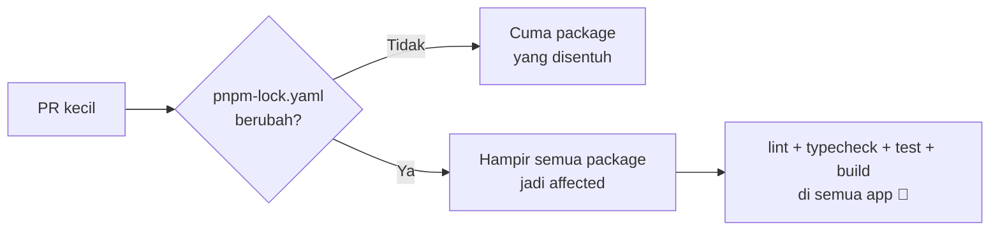

CI di monorepo frontend Invitato itu mahal, baik dari sisi biaya maupun waktu. Satu run bisa belasan sampai puluhan menit, dan kami sudah coba berbagai cara di level workflow, tapi hasilnya nggak seberapa. Akhirnya kami ganti toolchain-nya: ESLint ke **oxlint**, Prettier ke **oxfmt**, dan TypeScript 5.9 ke **TypeScript 7** yang native. Hasilnya, step "Lint, typecheck" di CI turun dari **254 detik ke 22,7 detik**, dan pre-commit hook dari 13 detik jadi **0,4 detik**.

## Background: CI yang mahal

`fe-monorepo` berisi semua frontend Invitato: landing page, dashboard klien, internal tools, engine undangan, sampai backend API-nya. Semuanya diatur pakai pnpm workspace dan [Turborepo](https://turborepo.com).

Masalahnya, setiap PR harus lewat lint, typecheck, test, dan build. Untuk repo sebesar ini, satu run CI bisa makan **belasan sampai puluhan menit**. Dan karena kami pakai runner sendiri (self-hosted, cuma satu), job dari PR yang berbeda saling antre. Pernah di satu PR, job yang tugasnya cuma "cek package mana yang berubah" antre **17 menit** di belakang job backend.

Jadi selain bayar mahal, developer juga harus nunggu lama cuma untuk tahu "PR saya lolos atau nggak?" :(

## Turbo affected: membantu, tapi...

Langkah pertama yang kami lakukan tentu saja: jangan jalankan semuanya. Turborepo punya fitur `--affected`, yang cuma menjalankan task untuk package yang berubah dan package lain yang bergantung padanya.

```bash
turbo run lint typecheck --filter="...[origin/main]"
```

Untuk PR yang cuma menyentuh satu app, ini sangat membantu. Tapi ada satu file yang bikin semua usaha ini sia-sia: **`pnpm-lock.yaml`**.

Begitu PR mengubah lockfile, entah karena nambah dependency, atau upgrade library, turbo menganggap semua package yang dependency-nya ikut berubah sebagai affected. Dan di monorepo, perubahan lockfile hampir selalu menyentuh banyak package sekaligus. Ujung-ujungnya, CI menjalankan **semuanya** lagi.



Kami juga sempat merapikan workflow-nya: pakai cache turbo yang persisten di runner, cancel run lama kalau ada push baru, dan skip job yang nggak relevan. Semuanya membantu sedikit, tapi nggak menyelesaikan masalah utamanya. Kalau semua package memang harus dicek, ya tetap lama.

Di sini kami sadar: **masalahnya bukan di berapa banyak yang dijalankan, tapi di seberapa lambat tool-nya sendiri.**

## Siapa yang paling lambat?

Kami ukur dulu. Ternyata tiga tool yang paling makan waktu adalah:

- **ESLint**: kalau dijumlah, sekitar 105 detik di semua package. Dashboard klien sendiri 19 detik.
- **Prettier**: `prettier --check` butuh 50 detik, dan lucunya sudah gagal di sekitar 2.400 file karena ada dua config Prettier yang saling bertentangan.
- **TypeScript 5.9**: `tsc` di semua package sekitar 150 detik.

Ketiganya ditulis di JavaScript, dan ketiganya sekarang sudah punya pengganti native yang jauh lebih cepat.

## Toolchain baru

| | Sebelum | Sesudah | Ditulis dengan |
|---|---|---|---|
| Lint | ESLint (dua versi, banyak config) | **oxlint**, satu `.oxlintrc.json` | Rust |
| Format | Prettier (2 config yang bentrok) | **oxfmt**, satu `.oxfmtrc.json` | Rust |
| Typecheck | TypeScript 5.9 | **TypeScript 7** | Go |

oxlint dan oxfmt adalah bagian dari project [Oxc](https://oxc.rs). Sementara TypeScript 7 adalah port compiler TypeScript ke Go yang dikerjakan langsung oleh tim TypeScript di Microsoft.

### Kenapa ESLint dibuang total?

Awalnya kepikiran opsi aman: oxlint untuk sebagian besar rule, ESLint tetap untuk sisanya. Tapi ternyata ini nggak bisa.

TypeScript 7.0 belum punya JS API, dan `typescript-eslint` nggak bisa jalan tanpa itu. Jadi kalau ESLint masih dipertahankan walaupun cuma untuk beberapa rule, seluruh repo harus tetap di TypeScript 6. Ya sudah, sekalian saja: ESLint pergi semua.

Yang penting, **setiap package tetap pakai rule set yang sama persis** seperti sebelumnya. Ini kami cek satu per satu, package per package, rule per rule, terhadap baseline ESLint.

### TypeScript 6 sebagai batu loncatan

Lompat langsung dari 5.9 ke 7 cukup berisiko, karena TS 7 menghapus beberapa opsi lama. Jadi kami naik ke TypeScript 6 dulu dan bereskan semua deprecation-nya, tanpa `ignoreDeprecations`:

- `moduleResolution: node` jadi `bundler`
- `target: es5` jadi `es2017`
- `baseUrl` dihapus

Setelah itu baru naik ke TypeScript 7. Karena Next.js biasanya memanggil TypeScript lewat JS API, kami set `experimental.useTypeScriptCli: true` supaya Next memanggil binary `tsc` langsung. Dan kami pastikan `next build` tetap **gagal kalau ada type error beneran**, bukan diam-diam lolos.

## Result

Semua angka ini diukur di mesin 4-core yang sama, tanpa cache turbo dan tanpa `tsbuildinfo`:

| Apa | Sebelum | Sesudah | Lebih cepat |
|---|---:|---:|---:|
| **CI step "Lint, typecheck"** (semua package) | 254,1 s | **22,7 s** | **11×** |
| **Pre-commit** (lint-staged, 8 file di 5 package) | 10,7–13,0 s | **0,3–0,4 s** | ~30× |
| Lint semua package (`turbo run lint`) | 49,5 s | 6,6 s | 7,5× |
| Lint satu repo dalam satu panggilan `oxlint` | – | **0,5 s** | |
| Format check satu repo | 44,6 s (dan gagal) | **0,5 s** (lolos) | ~90× |
| Typecheck semua package (`turbo run typecheck`) | 225,2 s | 24,6 s | 9× |
| Typecheck dashboard klien | 29,0 s | 8,3 s | 3,5× |
| Typecheck backend API | 29,4 s | 9,5 s | 3× |
| Build backend API (lint + tsc + tsc-alias) | 41,5 s | 11,9 s | 3,5× |

Yang paling kerasa sehari-hari justru **pre-commit**. Dulu setiap `git commit` harus nunggu 10–13 detik, sekarang selesai sebelum jari lepas dari tombol enter.

Dan untuk masalah `pnpm-lock.yaml` tadi: CI tetap menjalankan semua package, tapi sekarang "semua package" cuma butuh 22 detik, bukan 4 menit lebih. Masalahnya nggak hilang, tapi sudah nggak sakit lagi.

### Bonus: format check sekarang nggak perlu install

Karena oxfmt bisa jalan sendiri tanpa dependency lain, job format di CI sekarang nggak perlu `pnpm install` sama sekali. Cukup checkout, lalu:

```bash
pnpm dlx oxfmt@<versi> --check
```

Selesai dalam sekitar 1 detik, dan jalan di runner GitHub-hosted, jadi nggak ikut antre di runner self-hosted kami.

## Yang nggak semulus itu

Tentu saja nggak semuanya lancar. Beberapa hal yang lumayan bikin pusing:

- **oxlint JS plugin bikin CI crash.** Rule custom kami awalnya dibuat sebagai JS plugin oxlint. Di lokal aman, tapi di CI semua lint langsung abort. Ternyata dengan JS plugin, oxlint memesan sekitar 8 GiB address space per thread, dan runner kami menolaknya. Solusinya: rule-nya dipindah ke rule native (`no-restricted-properties`, `no-restricted-globals`) plus satu script kecil untuk cek nama file kebab-case. Bonusnya, lint jadi 0,5 detik, dari sebelumnya 1,9 detik.
- **Sort import ternyata bisa bikin test gagal.** Waktu import di-sort ke seluruh repo, 46 component test langsung merah. Ternyata urutan import itu penting: test harus import `@/test-kit` (yang mengarahkan API client ke mock server) sebelum import halaman yang dites. Akhirnya sort import cuma diaktifkan di dua package yang memang sudah pakai `simple-import-sort` dari dulu.
- **Satu commit reformat raksasa.** Karena format style-nya disatukan, ada satu commit yang menyentuh ribuan file. Commit ini kami daftarkan di `.git-blame-ignore-revs` supaya `git blame` tetap berguna. Konsekuensinya, PR ini wajib di-merge dengan merge commit, **bukan squash**, karena kalau di-squash, SHA commit reformat-nya hilang.
- **oxlint menemukan hal yang ESLint lewatkan.** Ada 5 optional chain yang nggak aman di test backend, langsung kami perbaiki. Ada juga 9 temuan React Compiler yang sudah ada dari dulu. Yang ini sengaja kami biarkan dengan komentar `oxlint-disable-next-line` beserta alasannya, supaya migrasi ini nggak mengubah behaviour apa pun.

## Masih ada PR berikutnya

Lint dan typecheck sudah beres, tapi CI belum sepenuhnya cepat. Masih ada beberapa hal yang antre:

- **Test backend.** Vitest menghabiskan 136 dari 222 detik cuma untuk "collect", karena setiap file test meng-import ulang seluruh app.
- **Runner kedua.** Dengan cuma satu runner self-hosted, job dari PR yang berbeda masih saling antre.
- **Type-aware linting.** Sekarang sudah di TypeScript 7, jadi kami bisa mulai coba tsgolint.

## Dikerjakan full dengan AI agent

Sama seperti [migrasi backend Invitato](/blog/invitato-backend-dari-google-sheet-ke-postgres/), seluruh pekerjaan ini dikerjakan **full oleh AI agent**, pakai [Claude Code](https://claude.com/claude-code). Mulai dari menulis ADR-nya, memigrasi config ESLint ke oxlint rule per rule, naik ke TypeScript 6 lalu 7, sampai mengukur semua benchmark di atas dan menulis deskripsi PR-nya.

Yang menurut saya paling menarik justru di bagian yang nggak mulus. Waktu CI crash karena JS plugin oxlint, agent-nya sendiri yang menelusuri penyebabnya, mereproduksinya di lokal dengan `ulimit -v`, lalu mengganti pendekatannya ke rule native. Begitu juga waktu 46 test gagal karena sort import: dia cari tahu kenapa, lalu mempersempit scope-nya, bukan memaksa test-nya lolos.

Peran saya lebih banyak di menentukan arah, menjawab pertanyaan, dan review hasil akhirnya. Total ada 14 commit yang menyentuh 3.000-an file, dan semuanya tetap bisa dibaca commit per commit.

Dan ini semua bisa kami lakukan tanpa mikirin biaya, karena Invitato sekarang didukung Anthropic lewat Claude Startup Program. Ceritanya ada di [Thank you, Claude for supporting Invitato via Startup Program!](/blog/thank-you-claude-startup-program/). Thank you, Anthropic!

## Penutup

Pelajaran terbesar buat saya: kalau optimasi di level workflow (cache, affected, skip job) sudah mentok, coba lihat tool-nya sendiri. Kadang yang lambat bukan cara kita menjalankannya, tapi apa yang kita jalankan.

Dan ekosistem tooling JavaScript sekarang lagi bergerak cepat ke native: Rust untuk lint dan format, Go untuk TypeScript. Migrasinya memang nggak gratis, PR ini menyentuh 3.000-an file. Tapi buat repo yang setiap PR-nya bayar mahal di CI, menurut saya ini salah satu investasi paling worth it yang pernah kami lakukan.

Semoga bermanfaat :)
