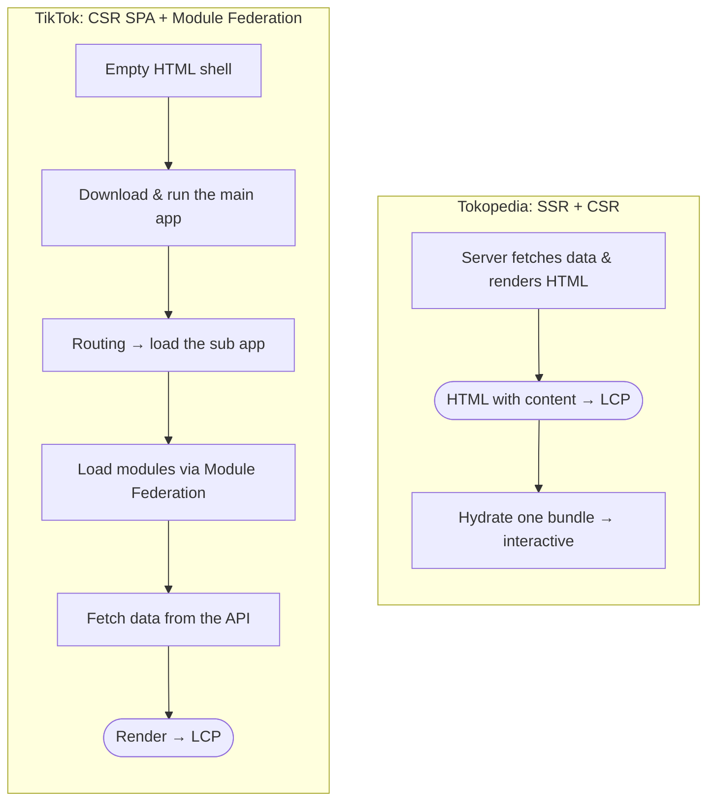

After ByteDance acquired Tokopedia, the two companies' Seller Centers were brought together. They do the same job, but they perform very differently: on Tokopedia desktop a 2-second LCP came easily, while TikTok Seller Center managed 5 seconds at best and 9 seconds at p75. This is part 1 of how we brought it under 3 seconds: gathering data, the quick wins that weren't enough, and the decision to change the architecture to an MPA.

## Background

One of ByteDance's first steps after the acquisition was to unify the platforms, both the infrastructure and the products users touch, since most of them do the same thing.

I owned Seller Center at Tokopedia, so in the unification project I also took on the Seller Platform for Southeast Asia.

The catch: even though the two seller platforms serve the same purpose, they are built on different architectures, and that choice is what made their performance so different. On Tokopedia desktop we hit a 2-second LCP without trying. On TikTok it was close to impossible: 5 seconds at best, and up to 9 seconds at p75.

Because the unification touched so many stakeholders, sellers included, complaints started coming in, and they all said the same thing: pages take too long to load.

So we took it seriously: how do we make TikTok Seller Center fast?

## Gathering Data First

The first step was a deep dive into every piece of data we could get: Chrome DevTools profiles, network quality, bundle sizes, and comparisons of architecture, frameworks and more.

We also compared performance across the other Southeast Asian regions closely, because the complaints were coming only from sellers in Indonesia.

## Iteration One: The Lowest Effort First

The data showed plenty of oversized bundles, some as large as 2MB just to download locale strings.

So we started with the cheapest fixes:

- Reduce bundle size.
- Lazy-load whatever isn't needed up front.
- Improve the loader.

The result? Still nothing significant. p75 only went from 9 seconds to 7.

## Iteration Two: The Problem Is the Architecture

After round after round of low-effort fixes, it became clear the problem lived at the architecture level. The two Seller Centers do the same job, but the way a page reaches a seller's screen is entirely different.

| | TikTok Seller Center | Tokopedia Seller Center |
| --- | --- | --- |
| Rendering | CSR, single-page app | SSR, then CSR after hydration |
| First HTML from the server | An empty shell | Already holds the content |
| Code structure | A main app as the gateway, a sub app per page, modules from many teams via Module Federation | One app, one bundle |
| What must finish before content shows | Main app → sub app → modules → data fetch → render | The server's HTML |
| When LCP happens | After that whole chain finishes | As soon as the HTML arrives and paints |

TikTok's teams are huge. Each team owns and maintains its own pages and modules, and almost all of them live in Module Federation. That is great for team independence, but the browser has to walk a long chain before it has any content to show. Every step is JavaScript to download, parse and run, one after another.

Tokopedia's is much leaner. The server fetches the data and renders the HTML first, so the content shows straight away. The single bundle of JavaScript only comes into play after that, to make the page interactive.

## Iteration Three: A New Architecture, MPA!

In the end we built a proof of concept for a new architecture. The infra team did most of the work here, and they chose an **MPA** (multi-page application).

Before that decision was made, though, there were long meetings. Back and forth, a PoC on a small page first, then more discussion. It was so tough that I had to fly to Shenzhen to see it through.

Finally the decision was made: we would really go with the MPA. I helped on the **Manage Product** page, one of the most visited pages in TikTok Seller Center.

## Problems During the Migration

TikTok's scope is enormous, and changing the architecture is never easy. So much got caught along the way:

- Packages that were no longer supported.
- Internal packages that didn't support the new setup.
- Different infrastructure.
- And, of course, an entirely different framework.

The migration really changed everything, literally. Even the code itself was copied over to a new home.

On top of that, the repo I owned deployed every single day. Can you imagine keeping the two in sync, every day?

That's the story for part 2. See you there!
