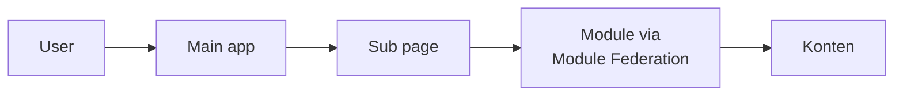
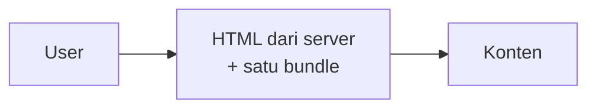
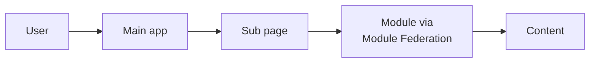
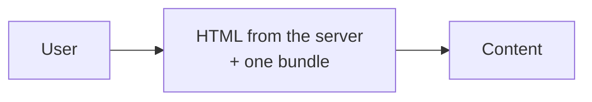

Setelah Tokopedia diakuisisi ByteDance, Seller Center Tokopedia dan TikTok disatukan. Fungsinya sama, tapi performanya jauh beda: di Tokopedia desktop, LCP 2 detik itu gampang, sedangkan di TikTok Seller Center paling cepat 5 detik dan p75-nya tembus 9 detik. Ini part 1 dari cerita gimana kita menurunkannya ke bawah 3 detik, mulai dari kumpulin data, quick win yang ternyata nggak cukup, sampai keputusan ganti arsitektur ke MPA.

_English version is [below](#english-version)._

## Latar Belakang

Setelah Tokopedia diakuisisi ByteDance, salah satu langkah pertama yang dilakukan adalah menyatukan platform, baik dari sisi infra maupun platform yang dipakai user. Wajar, karena fungsinya kebanyakan sama.

Waktu di Tokopedia saya pegang Seller Center, jadi di project unify ini saya juga pegang Seller Platform untuk wilayah SEA.

Masalahnya, walaupun fungsi seller platform di Tokopedia dan TikTok itu sama, arsitekturnya beda. Dan pilihan arsitektur inilah yang bikin performanya beda jauh. Di Tokopedia desktop, kita gampang banget dapet LCP 2 detik. Di TikTok, itu hampir nggak mungkin: paling cepat 5 detik, dan p75-nya bisa sampai 9 detik.

Karena proses unify ini menyentuh banyak stakeholder, termasuk seller sendiri, komplain mulai berdatangan. Isinya kurang lebih sama: halamannya loading-nya lama.

Akhirnya kita ambil issue ini dengan serius: gimana caranya improve performa TikTok Seller Center?

## Kumpulin Data Dulu

Langkah pertama, kita deep dive ke semua data yang bisa kita dapat. Profiling dari Chrome DevTools, kualitas network, bundle size, perbandingan arsitektur, framework, dan lain-lain.

Kita juga benar-benar membandingkan performanya dengan region lain di SEA, karena komplainnya cuma datang dari seller Indonesia.

## Iterasi Pertama: Ambil yang Paling Low Effort

Dari data yang kita temukan, banyak banget bundle yang ukurannya besar. Ada yang sampai 2MB, cuma buat download teks locale.

Jadi kita mulai dari yang paling murah:

- Mengurangi bundle size.
- Lazy load apa yang belum dibutuhkan di awal.
- Memperbaiki loader.

Hasilnya? Tetap nggak signifikan. p75 cuma turun dari 9 detik ke 7 detik.

## Iterasi Kedua: Masalahnya di Arsitektur

Setelah iterasi demi iterasi di sisi low effort, kelihatan jelas bahwa masalahnya memang di level arsitektur.

- **TikTok:** full CSR SPA + Module Federation.
- **Tokopedia:** SSR + CSR.

Tim di TikTok itu besar banget. Masing-masing tim punya page dan module sendiri yang mereka maintain, dan hampir semuanya ditaruh di Module Federation. Hasilnya, ada main app yang berperan sebagai gateway, dan setiap halaman harus melewati rantai panjang sebelum kontennya muncul:

Tokopedia jauh lebih ringkas. Halamannya sudah di-render di server duluan, dan sisanya sudah jadi satu bundle. Rantainya lebih pendek, jadi lebih cepat:

## Iterasi Ketiga: Arsitektur Baru, MPA!

Akhirnya kita bikin PoC untuk mengubah arsitektur. Di bagian ini yang paling banyak bekerja adalah tim infra, dan mereka memutuskan untuk pakai **MPA** (multi-page application).

Tapi sebelum keputusan itu diambil, kita meeting lama banget. Bolak-balik, PoC ke halaman kecil dulu, diskusi lagi. Meetingnya alot sekali, sampai saya harus ke Shenzhen untuk menyelesaikannya.

Akhirnya keputusan diambil: kita benar-benar go dengan MPA. Saya bantu di halaman **Manage Product**, salah satu halaman yang paling banyak dikunjungi di TikTok Seller Center.

## Masalah Ketika Migrasi

Scope TikTok itu sudah luar biasa besar, dan mengganti arsitektur bukan hal yang gampang. Banyak sekali yang ikut kesenggol:

- Package yang sudah nggak support.
- Internal package yang nggak support.
- Infra yang beda.
- Dan jelas, framework yang berubah total.

Migrasinya benar-benar berubah total, literally. Bahkan kodenya pun di-copy ke tempat baru.

Ditambah lagi, repo yang saya pegang itu ada deployment setiap hari. Kebayang kan, gimana caranya tetap sync setiap hari?

Itu cerita di part 2. Sampai jumpa di sana!

## English Version

After ByteDance acquired Tokopedia, the two companies' Seller Centers were brought together. They do the same job, but they perform very differently: on Tokopedia desktop a 2-second LCP came easily, while TikTok Seller Center managed 5 seconds at best and 9 seconds at p75. This is part 1 of how we brought it under 3 seconds: gathering data, the quick wins that weren't enough, and the decision to change the architecture to an MPA.

## Background

One of ByteDance's first steps after the acquisition was to unify the platforms, both the infrastructure and the products users touch, since most of them do the same thing.

I owned Seller Center at Tokopedia, so in the unification project I also took on the Seller Platform for Southeast Asia.

The catch: even though the two seller platforms serve the same purpose, they are built on different architectures, and that choice is what made their performance so different. On Tokopedia desktop we hit a 2-second LCP without trying. On TikTok it was close to impossible: 5 seconds at best, and up to 9 seconds at p75.

Because the unification touched so many stakeholders, sellers included, complaints started coming in, and they all said the same thing: pages take too long to load.

So we took it seriously: how do we make TikTok Seller Center fast?

## Gathering Data First

The first step was a deep dive into every piece of data we could get: Chrome DevTools profiles, network quality, bundle sizes, and comparisons of architecture, frameworks and more.

We also compared performance across the other Southeast Asian regions closely, because the complaints were coming only from sellers in Indonesia.

## Iteration One: The Lowest Effort First

The data showed plenty of oversized bundles, some as large as 2MB just to download locale strings.

So we started with the cheapest fixes:

- Reduce bundle size.
- Lazy-load whatever isn't needed up front.
- Improve the loader.

The result? Still nothing significant. p75 only went from 9 seconds to 7.

## Iteration Two: The Problem Is the Architecture

After round after round of low-effort fixes, it became clear the problem lived at the architecture level.

- **TikTok:** a fully client-rendered SPA plus Module Federation.
- **Tokopedia:** SSR plus CSR.

TikTok's teams are huge. Each team owns and maintains its own pages and modules, and almost all of them live in Module Federation. The result is a main app acting as a gateway, and every page walks a long chain before its content appears:

Tokopedia's is much leaner. Pages are rendered on the server first, and the rest ships as a single bundle. A shorter chain, so a faster page:

## Iteration Three: A New Architecture, MPA!

In the end we built a proof of concept for a new architecture. The infra team did most of the work here, and they chose an **MPA** (multi-page application).

Before that decision was made, though, there were long meetings. Back and forth, a PoC on a small page first, then more discussion. It was so tough that I had to fly to Shenzhen to see it through.

Finally the decision was made: we would really go with the MPA. I helped on the **Manage Product** page, one of the most visited pages in TikTok Seller Center.

## Problems During the Migration

TikTok's scope is enormous, and changing the architecture is never easy. So much got caught along the way:

- Packages that were no longer supported.
- Internal packages that didn't support the new setup.
- Different infrastructure.
- And, of course, an entirely different framework.

The migration really changed everything, literally. Even the code itself was copied over to a new home.

On top of that, the repo I owned deployed every single day. Can you imagine keeping the two in sync, every day?

That's the story for part 2. See you there!

