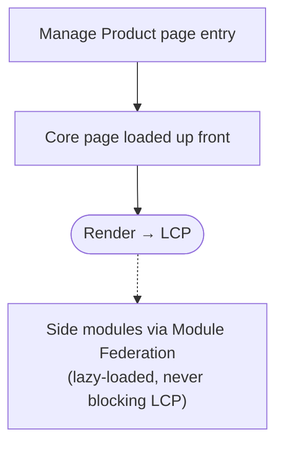

After ByteDance acquired Tokopedia, the two companies' Seller Centers were brought together. They do the same job, but they perform very differently: on Tokopedia desktop a 2-second LCP came easily, while TikTok Seller Center managed 5 seconds at best (testing locally on the office connection) and 9 seconds at p75. This is part 1 of how we brought it under 3 seconds: gathering data, the quick wins that weren't enough, the decision to change the architecture to an MPA, and the start of the migration.

## Background

One of ByteDance's first steps after the acquisition was to unify the platforms, both the infrastructure and the products users touch, since most of them do the same thing.

I owned Seller Center at Tokopedia, so in the unification project I also took on the Seller Platform for Southeast Asia.

The catch: even though the two seller platforms serve the same purpose, they are built on different architectures, and that choice is what put their performance so far apart.

Because the unification touched so many stakeholders, sellers included, complaints started coming in, and they all said the same thing: pages take too long to load.

So we took it seriously: how do we make TikTok Seller Center fast?

## Gathering Data First

The first step was a deep dive into every piece of data we could get: Chrome DevTools profiles, network quality, bundle sizes, and comparisons of architecture, frameworks and more.

We also compared performance across the other Southeast Asian regions closely, because the complaints were coming only from sellers in Indonesia.

The answer turned out to be simple: Indonesian sellers had been using Tokopedia's Seller Center. They were used to pages that showed up in 2 seconds, so the moment they moved to TikTok Seller Center, the slowness was obvious.

## Iteration One: The Lowest Effort First

The data showed plenty of oversized bundles, some as large as 2MB just to download locale strings.

So we started with the cheapest fixes:

- Reduce bundle size.
- Lazy-load whatever isn't needed up front.
- Improve the loader.

The result? p75 only went from 9 seconds to 7. Still a long way from the target of under 3.

## The Root Cause: Architecture

After round after round of low-effort fixes, it became clear the problem lived at the architecture level. The two Seller Centers do the same job, but the way a page reaches a seller's screen is entirely different.

| | TikTok Seller Center | Tokopedia Seller Center |
| --- | --- | --- |
| Rendering | CSR, single-page app | SSR, then CSR after hydration |
| First HTML from the server | An empty shell | Already holds the content |
| Code structure | A main app as the gateway, a sub app per page, modules from many teams via Module Federation | One app, one bundle |
| What must finish before content shows | Main app → sub app → modules → data fetch → render | The server's HTML |
| When LCP happens | After that whole chain finishes | As soon as the HTML arrives and paints |

TikTok's teams are huge. Each team owns and maintains its own pages and modules, and almost all of them live in Module Federation. That is great for team independence, but the browser has to walk a long chain before it has any content to show. Every step is JavaScript to download, parse and run, one after another.

Tokopedia's setup is much leaner. The server fetches the data and renders the HTML first, so the content shows straight away. The single bundle of JavaScript only comes into play after that, to make the page interactive.

## Iteration Two: A New Architecture, MPA!

In the end we built a proof of concept for a new architecture. The infra team did most of the work here, and they chose an **MPA** (multi-page application).

Before that decision was made, though, there were long meetings. Back and forth, a PoC on a small page first, then more discussion. It was so tough that I had to fly to Shenzhen to see it through. The hard part wasn't the MPA itself but how to get it done: how to split the work, how teams would share packages, and which technical approach to use during the migration.

Finally the decision was made: we would really go with the MPA. I helped on the **Manage Product** page, one of the most visited pages in TikTok Seller Center.

Why an MPA? TikTok Seller Center's scope was already too big. Going back to a single app was out of the question, and working around the chain with Module Federation had hit its limits too.

With an MPA, every page has its own entry. When a seller opens Manage Product, what loads is the Manage Product page itself, not a main app that then goes looking for the right sub app.

We still use the idea of Module Federation, but only for side modules: the parts that don't decide LCP, lazy-loaded so they never block it. Every core page is loaded up front, so LCP no longer shifts whenever another team's module changes.

A bonus: every page can control its own deployments. For an organisation at TikTok's scale, that is far more flexible and scalable for each team.

## The Migration: Connecting Every Stakeholder

At this point the engineers had agreed. The other stakeholders hadn't yet.

So we set up a kick-off meeting to align with Product and QA. From there we prepared:

- **A PRD and a tech plan**, so everyone understood what was changing and why.
- **The metric we wanted to hit:** LCP at or under 3 seconds, so the target was clear and measurable.
- **A timeline.** This one really mattered, because we were bringing QA in to regression-test every feature!

Only once everyone was aligned did we move on to the migration itself.

## Problems During the Migration

TikTok's scope is enormous, and changing the architecture is never easy. A lot broke along the way:

- Packages that were no longer supported.
- Internal packages that didn't support the new setup.
- Different infrastructure.
- And, of course, an entirely different framework.

We were literally starting over: even the code was copied into a new branch of the same repo.

On top of that, the repo I owned deployed every single day, so the main branch kept moving for as long as the migration ran. Can you imagine keeping the migration branch in sync, every day?

That's the story for [part 2](/blog/improve-lcp-tiktok-seller-center-part-2). See you there!
