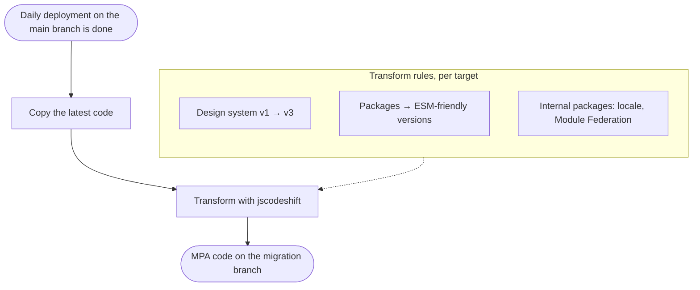
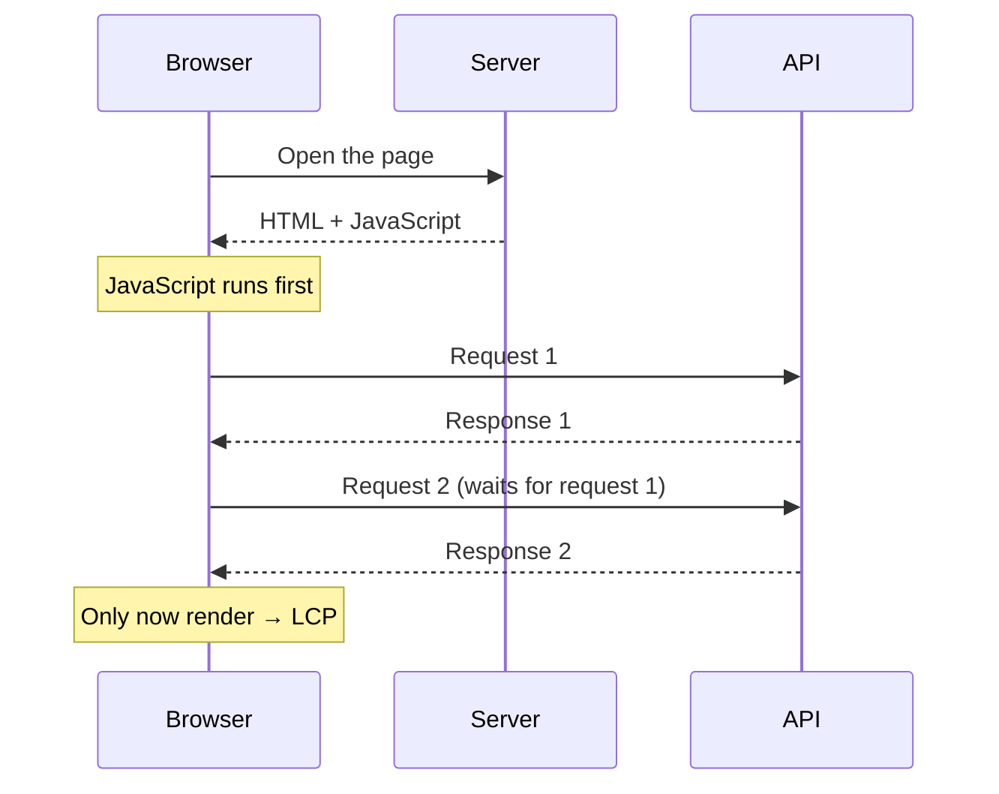
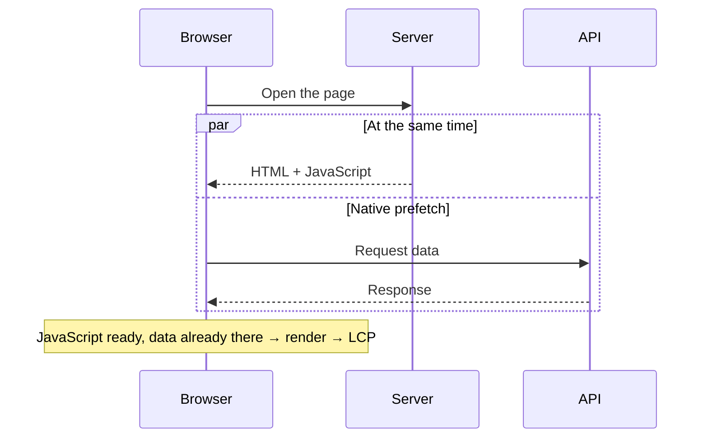
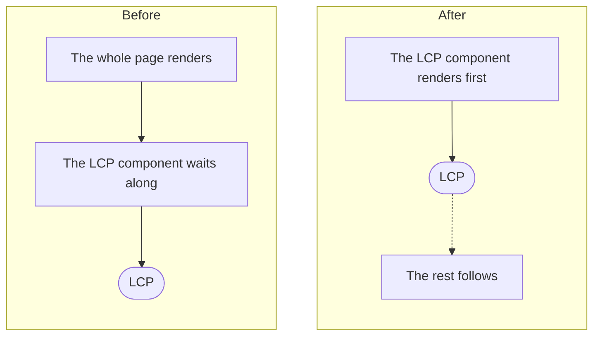

In [part 1](/blog/improve-lcp-tiktok-seller-center-part-1) we got as far as the decision to move to an MPA and the start of the migration. Part 2 is the rest: how the migration ran with no code freeze at all, why moving to an MPA wasn't enough on its own, and how a staged rollout finally brought TikTok Seller Center's p75 LCP steadily under 3 seconds.

## Migrating Without a Code Freeze

The first problem, and one of the hardest: we weren't allowed to stop product development at all. Every team kept working as usual, with no code freeze of any kind.

And, as part 1 ended, the repo I owned deployed every day. The code on the old architecture kept changing while we were moving it to the new one on another branch.

So together with the TikTok infra team in China, I built a tool to do **code-sync**.

## Code-Sync: One Codebase, Two Architectures

Put simply, code-sync turns the existing code into code that works with the MPA. It sounds simple, but the challenge was big. The UI library stayed React, but the framework we built on top of it went from SPA to MPA, and almost everything underneath changed with it:

- **The design system** changed, because we upgraded it from v1 to v3 along the way. Every one a major version!
- **Every package** had to move to an ESM-friendly version.
- **Internal packages**, like locale and Module Federation, all had to line up too.

The infra team built the MPA infra and framework themselves. Code-sync's job was to make sure our product code moved over with it, every single day.

How it works: code-sync copies the code from the main branch, then maps it onto the new versions according to targets we define. Its main engine is [jscodeshift](https://github.com/facebook/jscodeshift), which rewrites code through its AST rather than by find-and-replace on text.

Code-sync made all the difference, because a run takes only 2–3 minutes. We ran it every time a deployment finished, so the migration branch always followed the latest code and nobody had to stop working.

## An MPA Alone Wasn't Enough

The second problem: moving to an MPA didn't by itself bring the Manage Product page's LCP to 3 seconds.

We also had to change how some critical components were written, so the other Core Web Vitals would be good too.

After fixing them one by one, local testing reached **1 second**. Great!

## A Staged Rollout, Starting with Indonesia

Because the scope was so big, we didn't deploy to every Southeast Asian region at once. We rolled out in stages, starting with Indonesia. Why? Because that's where most of the complaints came from.

Once it was live, p75 was much better, but still at 4–5 seconds. That was to be expected: local testing ran on the office connection, while p75 in production comes from sellers' many networks and devices. Still, it wasn't on target yet.

## The APIs Were Called One After Another

Once again we profiled, and the problem turned out to be **sequential** API calls. The page had to wait for its JavaScript to run before the first request went out, and each request after that waited for the previous one. Only once all the data arrived could the content render.

We fixed the flow by implementing **native prefetch** in our MPA infra. The goal: the moment a page opens, its data requests are already running alongside the page itself. By the time the JavaScript is ready, the data is there too, and the page can be genuinely fast.

After this, we got to **around 3 seconds**! So we carried the rollout on to the other regions, watching performance as we went.

## Rendering the LCP Component First

We also improved how components render, so the component targeted as the LCP element could show earlier and more consistently, without waiting on parts of the page that don't matter up front.

With this in place, p75 LCP held steady under 3 seconds, in the **2–3 second** range. Target achieved!

## Wrapping Up

Long story short, this MPA project went on to become the platform foundation of TikTok Seller Center. I'm quite proud to have been one of its founding engineers, hahaha!

Even though I was still new there, making an impact this big at the scale of a company like TikTok was an amazing experience.
