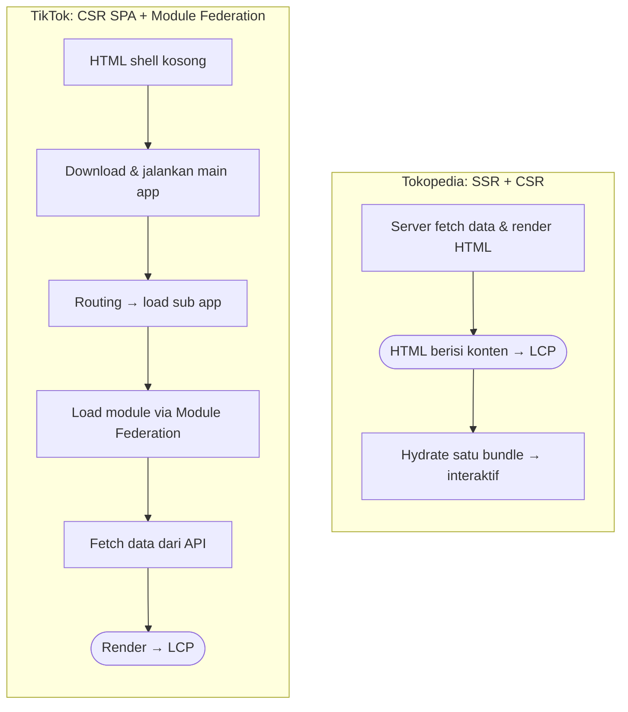
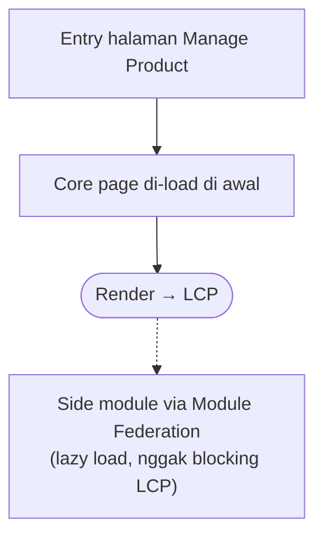

Setelah Tokopedia diakuisisi ByteDance, Seller Center Tokopedia dan TikTok disatukan. Fungsinya sama, tapi performanya jauh beda: di Tokopedia desktop, LCP 2 detik itu gampang, sedangkan di TikTok Seller Center paling cepat 5 detik (testing lokal pakai koneksi kantor) dan p75-nya tembus 9 detik. Ini part 1 dari cerita gimana kita menurunkannya ke bawah 3 detik: kumpulin data, quick win yang ternyata nggak cukup, keputusan ganti arsitektur ke MPA, sampai mulai migrasinya.

## Latar Belakang

Setelah Tokopedia diakuisisi ByteDance, salah satu langkah pertama yang dilakukan adalah menyatukan platform, baik dari sisi infra maupun platform yang dipakai user. Wajar, karena fungsinya kebanyakan sama.

Waktu di Tokopedia saya pegang Seller Center, jadi di project unify ini saya juga pegang Seller Platform untuk wilayah SEA.

Masalahnya, walaupun fungsi seller platform di Tokopedia dan TikTok itu sama, arsitekturnya beda. Dan pilihan arsitektur inilah yang bikin performanya beda sejauh itu.

Karena proses unify ini menyentuh banyak stakeholder, termasuk seller sendiri, komplain mulai berdatangan. Isinya kurang lebih sama: loading halamannya lama.

Akhirnya kita ambil issue ini dengan serius: gimana caranya improve performa TikTok Seller Center?

## Kumpulin Data Dulu

Langkah pertama, kita deep dive ke semua data yang bisa kita dapet. Profiling dari Chrome DevTools, kualitas network, bundle size, perbandingan arsitektur, framework, dan lain-lain.

Kita juga benar-benar membandingkan performanya dengan region lain di SEA, karena komplainnya cuma datang dari seller Indonesia.

Ternyata jawabannya sederhana: seller Indonesia sebelumnya pakai Seller Center Tokopedia. Mereka sudah terbiasa dengan halaman yang tampil dalam 2 detik, jadi begitu pindah ke TikTok Seller Center, lambatnya langsung terasa.

## Iterasi Pertama: Ambil yang Paling Low Effort

Dari data yang kita temukan, banyak banget bundle yang ukurannya besar. Ada yang sampai 2MB, cuma buat download teks locale.

Jadi kita mulai dari yang paling murah:

- Mengurangi bundle size.
- Lazy load apa yang belum dibutuhkan di awal.
- Memperbaiki loader.

Hasilnya? p75 cuma turun dari 9 detik ke 7 detik. Masih jauh dari target di bawah 3 detik.

## Akar Masalahnya: Arsitektur

Setelah iterasi demi iterasi di sisi low effort, kelihatan jelas bahwa masalahnya memang di level arsitektur. Fungsi kedua Seller Center sama, tapi cara halamannya sampai ke layar seller beda total.

| | TikTok Seller Center | Tokopedia Seller Center |
| --- | --- | --- |
| Rendering | CSR, single-page app | SSR, lalu CSR setelah hydrate |
| HTML pertama dari server | Shell kosong | Sudah berisi konten |
| Struktur kode | Main app sebagai gateway, sub app per halaman, module dari banyak tim lewat Module Federation | Satu app, satu bundle |
| Yang harus selesai sebelum konten tampil | Main app → sub app → module → fetch data → render | HTML dari server |
| Kapan LCP terjadi | Setelah seluruh rantai di atas selesai | Begitu HTML diterima dan di-paint |

Tim di TikTok itu besar banget. Masing-masing tim punya page dan module sendiri yang mereka maintain, dan hampir semuanya ditaruh di Module Federation. Itu bagus buat kemandirian tim, tapi browser jadi harus melewati rantai panjang dulu sebelum ada konten yang bisa ditampilkan. Setiap langkahnya adalah download, parse, dan eksekusi JavaScript, dan semuanya berurutan.

Tokopedia jauh lebih ringkas. Server sudah ambil data dan render HTML duluan, jadi konten langsung tampil. JavaScript yang satu bundle itu baru dipakai setelahnya, untuk bikin halamannya interaktif.

## Iterasi Kedua: Arsitektur Baru, MPA!

Akhirnya kita bikin PoC untuk mengubah arsitektur. Di bagian ini yang paling banyak bekerja adalah tim infra, dan mereka memutuskan untuk pakai **MPA** (multi-page application).

Tapi sebelum keputusan itu diambil, kita meeting lama banget. Bolak-balik, PoC ke halaman kecil dulu, diskusi lagi. Meetingnya alot sekali, sampai saya harus ke Shenzhen untuk menyelesaikannya. Yang alot justru bukan soal MPA-nya, tapi pengerjaannya: gimana pembagian kerjanya, gimana proses sharing package antar tim, dan pendekatan teknis apa yang dipakai selama migrasi.

Akhirnya keputusan diambil: kita benar-benar go dengan MPA. Saya bantu di halaman **Manage Product**, salah satu halaman yang paling banyak dikunjungi di TikTok Seller Center.

Kenapa MPA? Scope TikTok Seller Center sudah terlalu besar. Kembali ke satu app jelas nggak mungkin, dan mengakali rantainya dengan Module Federation juga sudah mentok.

Dengan MPA, setiap halaman punya entry sendiri. Begitu seller buka Manage Product, yang di-load langsung halaman Manage Product itu sendiri, bukan main app yang baru kemudian mencari sub app-nya.

Konsep Module Federation tetap kita pakai, tapi cuma untuk side module: bagian yang nggak menentukan LCP, dan di-lazy load supaya nggak blocking. Semua core page di-load di awal, jadi LCP nggak lagi ikut berubah setiap kali module tim lain berubah.

Bonusnya, setiap halaman bisa mengatur deployment-nya sendiri. Buat organisasi selevel TikTok, ini jauh lebih fleksibel dan scalable untuk masing-masing tim.

## Proses Migrasi: Connect ke Semua Stakeholder

Di titik ini, engineer sudah setuju. Tapi stakeholder lain belum.

Jadi kita set kick-off meeting untuk align dengan Product dan QA. Dari situ kita siapkan:

- **PRD dan tech plan**, supaya semua orang paham apa yang berubah dan kenapa.
- **Metrik yang ingin kita capai:** LCP di bawah atau sama dengan 3 detik, supaya targetnya jelas dan bisa diukur.
- **Timeline.** Ini penting banget, karena kita melibatkan QA untuk regression test semua fitur!

Baru setelah semuanya align, kita masuk ke proses migrasinya.

## Masalah Ketika Migrasi

Scope TikTok itu sudah luar biasa besar, dan mengganti arsitektur bukan hal yang gampang. Banyak sekali yang ikut kesenggol:

- Package yang sudah nggak support.
- Internal package yang nggak support.
- Infra yang beda.
- Dan jelas, framework yang berubah total.

Literally mulai dari nol, sampai kodenya pun kita copy ke branch baru di repo yang sama.

Ditambah lagi, repo yang saya pegang itu ada deployment setiap hari. Jadi selama migrasi berjalan, branch utamanya terus berubah. Kebayang kan, gimana caranya branch migrasi tetap sync setiap hari?

Itu cerita di part 2. Sampai jumpa di sana!
