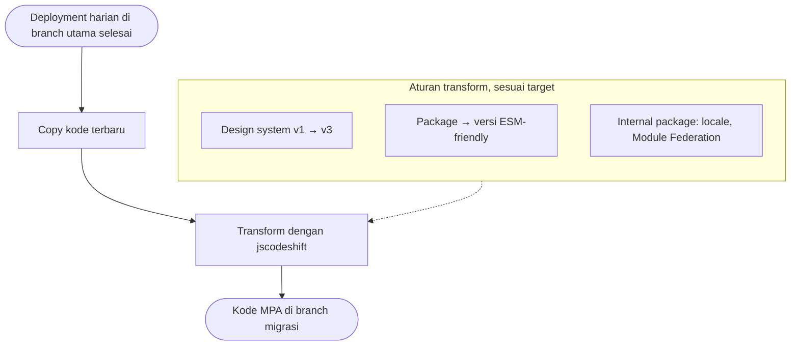
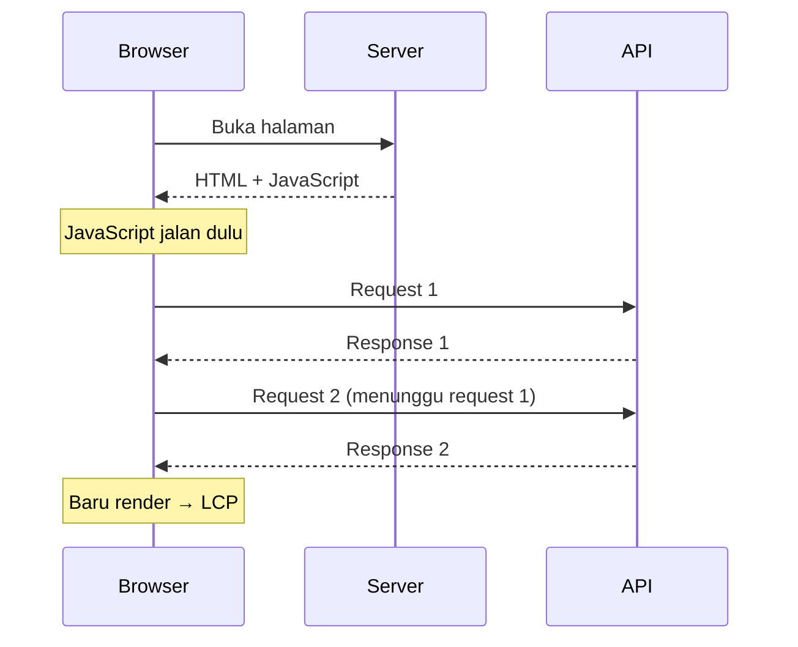
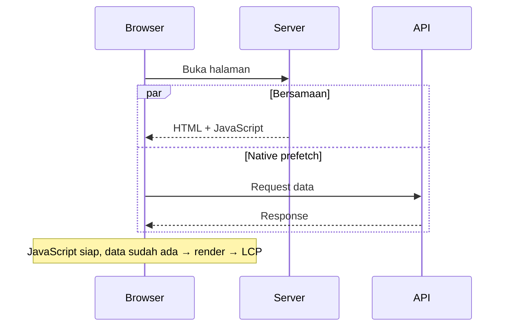
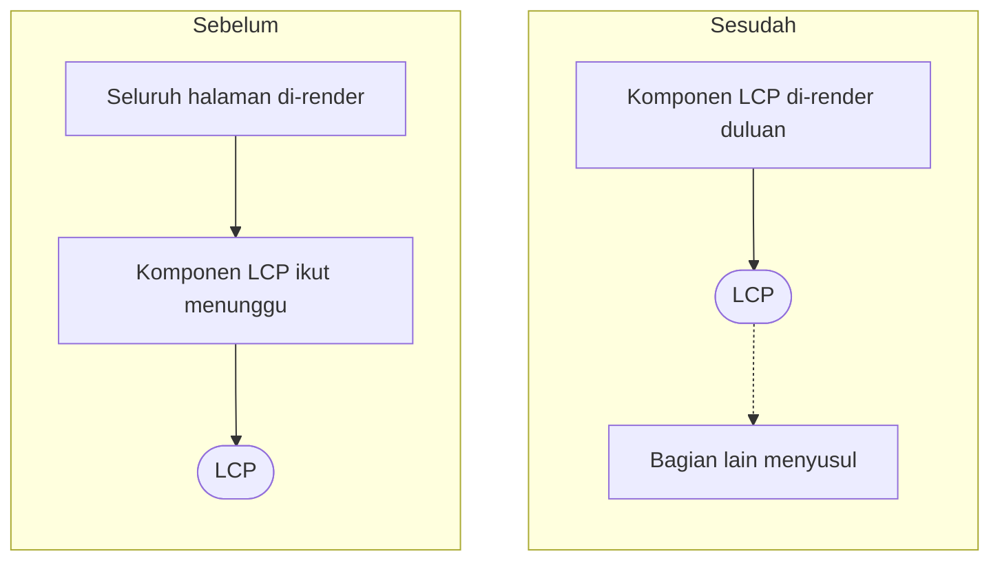

Di [part 1](/blog/menurunkan-lcp-tiktok-seller-center-part-1), kita sampai di keputusan pindah ke MPA dan mulai migrasi. Part 2 ini soal sisanya: gimana migrasinya jalan tanpa code freeze sama sekali, kenapa pindah ke MPA aja ternyata belum cukup, dan gimana rollout bertahap akhirnya bikin LCP p75 TikTok Seller Center konsisten di bawah 3 detik.

## Migrasi Tanpa Code Freeze

Masalah pertama, dan salah satu yang paling berat: kita nggak boleh menghentikan product development sama sekali. Semua tim jalan seperti biasa, tanpa code freeze apa pun.

Padahal, seperti di akhir part 1, repo yang saya pegang ada deployment setiap hari. Jadi kode di arsitektur lama terus berubah, sementara kita sedang memindahkannya ke arsitektur baru di branch lain.

Akhirnya saya bareng tim infra TikTok di China bikin tools untuk melakukan **code-sync**.

## Code-Sync: Satu Kode, Dua Arsitektur

Simpelnya, code-sync mengubah kode yang sudah ada menjadi kode yang compatible dengan MPA. Kedengarannya sederhana, tapi tantangannya besar. Library UI-nya memang tetap React, tapi framework yang kita bangun di atasnya berganti dari SPA ke MPA, dan isi di dalamnya ikut berubah total:

- **Design system** berubah, karena kita sekalian update dari v1 ke v3. Major version semua!
- **Semua package** harus diganti ke versi yang ESM-friendly.
- **Internal package**, seperti locale dan Module Federation, semuanya harus ikut align.

Infra dan framework MPA-nya sendiri dikerjakan tim infra. Tugas code-sync memastikan kode produk kita ikut pindah ke sana, setiap hari.

Cara kerjanya: code-sync meng-copy kode dari branch utama, lalu memetakan isinya ke versi baru sesuai target yang kita tentukan. Mesin utamanya [jscodeshift](https://github.com/facebook/jscodeshift), yang mengubah kode lewat AST, bukan cari-dan-ganti teks biasa.

Code-sync ini benar-benar membantu, karena prosesnya cuma butuh 2–3 menit. Kita jalankan setiap kali deployment selesai, jadi branch migrasi selalu ikut kode terbaru tanpa ada yang perlu berhenti kerja.

## MPA Saja Belum Cukup

Masalah kedua: pindah ke MPA nggak serta-merta bikin LCP halaman Manage Product langsung 3 detik.

Kita juga perlu mengubah cara beberapa komponen kritis ditulis, supaya Core Web Vitals lainnya ikut bagus.

Setelah kita perbaiki satu per satu, di testing lokal kita bisa mencapai **1 detik**. Great!

## Rollout Bertahap, Mulai dari Indonesia

Karena scope-nya besar sekali, kita nggak langsung deploy ke seluruh region SEA. Kita rollout bertahap, mulai dari Indonesia. Kenapa? Karena komplainnya paling banyak datang dari sana.

Setelah naik, p75-nya jauh lebih bagus, tapi masih di angka 4–5 detik. Wajar sih, testing lokal pakai koneksi kantor, sedangkan p75 di production datang dari jaringan dan device seller yang beragam. Tapi tetap aja, belum sesuai target.

## Ternyata API-nya Dipanggil Berurutan

Lagi-lagi kita profiling, dan ternyata masalahnya ada di pemanggilan API yang **berurutan**. Halaman harus menunggu JavaScript-nya jalan dulu, baru request pertama dikirim, lalu request berikutnya menunggu yang sebelumnya selesai. Baru setelah semua data datang, konten bisa di-render.

Akhirnya kita perbaiki prosesnya dengan mengimplementasikan **native prefetch** di infra MPA kita. Tujuannya, begitu halaman dibuka, request datanya sudah jalan bersamaan dengan halamannya. Jadi waktu JavaScript siap, datanya juga sudah ada, dan halamannya bisa benar-benar cepat.

Setelah ini, kita dapet angka **sekitar 3 detik**! Akhirnya kita lanjutkan rollout ke region lain, sambil terus memantau performanya.

## Render Komponen LCP Lebih Awal

Kita juga memperbaiki cara komponen di-render, supaya komponen yang jadi target LCP bisa tampil lebih awal dan konsisten, tanpa menunggu bagian halaman yang nggak penting di awal.

Dengan implementasi ini, LCP p75 konsisten di bawah 3 detik, di kisaran **2–3 detik**. Target achieved!

## Penutup

Singkat cerita, project MPA ini kemudian jadi basis platform di TikTok Seller Center. Saya cukup bangga bisa jadi salah satu founding engineer-nya, hahaha!

Walaupun waktu itu saya masih baru di sana, bisa bikin impact sebesar ini di level company seperti TikTok benar-benar pengalaman yang luar biasa.
